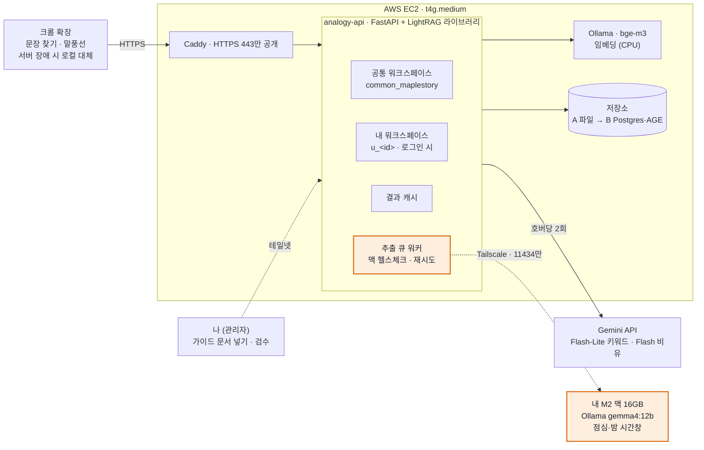
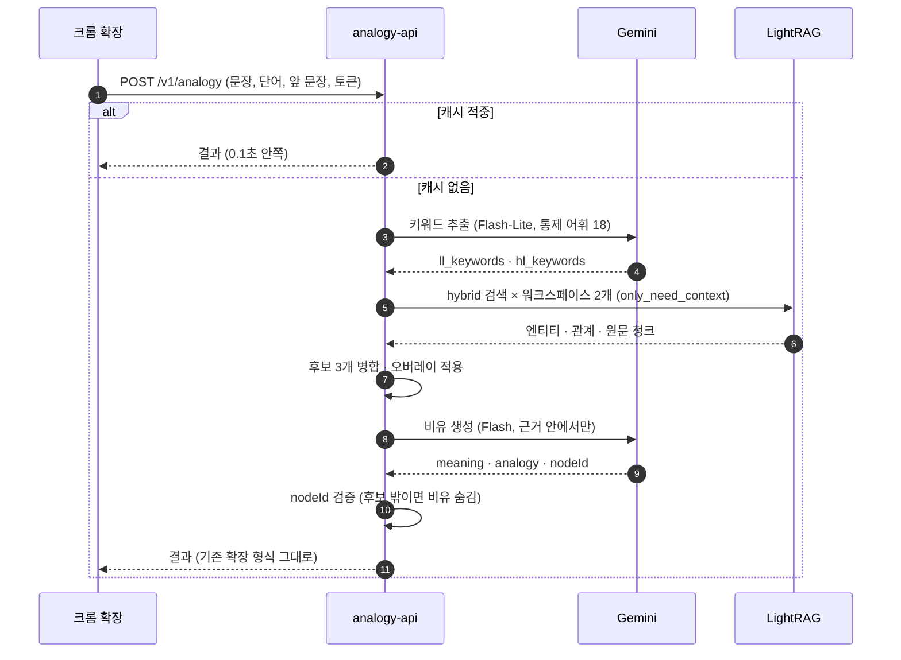
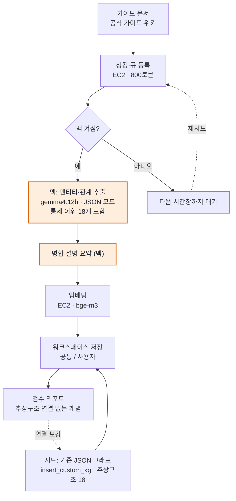
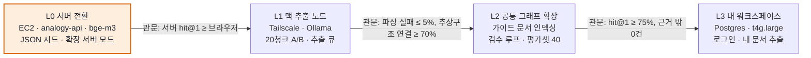

# LightRAG 기반 아키텍처 설계

- 상태: 설계 (2026-09-29). 결정 기록은 [ADR 0006](decisions/0006-lightrag-server.md), 작업은 [TASKS.md](TASKS.md)의 LightRAG 트랙(T-4xx).
- 살아 있는 문서(그림 포함): https://claude.ai/code/artifact/af5b42e7-dd31-4b10-a409-5775f83e2e3e
- 그림으로 보기: [`architecture-lightrag.html`](architecture-lightrag.html) (이 문서의 시각화 버전, 경로 강조 토글 포함), [`intro.html`](intro.html)의 "다음 아키텍처" 섹션
- 아래 그림은 Mermaid라 GitHub에서 바로 그려진다. 내용을 바꾸면 HTML 페이지의 그림도 함께 고친다.

## 결론

EC2 한 대에 LightRAG를 라이브러리로 감싼 `analogy-api`를 두고, 엔티티·관계 추출만 Tailscale로 M2 맥의 Ollama에 맡긴다. 호버 때 부르는 LLM(키워드·비유)은 맥이 꺼져 있어도 돼야 하므로 클라우드(Gemini 무료 티어)를 쓴다. PoC 월 비용은 약 $31이다.

| 역할 | 어디서 | 무엇으로 | 언제 |
| --- | --- | --- | --- |
| 엔티티·관계 추출, 설명 병합 요약 (인덱싱) | M2 맥, Tailscale 너머 호출 | Ollama `gemma4:12b` (비교 `qwen3.5:9b`) | 배치: 점심·밤 시간창 |
| 임베딩 (인덱싱·질의 공통) | EC2 | Ollama `bge-m3` (CPU) | 항상 |
| 그래프·벡터 검색 | EC2 | LightRAG 라이브러리, 워크스페이스별 인스턴스 | 항상 |
| 키워드 추출·비유 생성 (질의) | 클라우드 | Gemini Flash-Lite / Flash | 호버마다 |
| 확장 | 사용자 크롬 | 얇은 클라이언트 + 기존 브라우저 파이프라인은 오프라인 대체 | 항상 |

LightRAG를 고른 이유 (LightRAG 워크북 기준):

- **커뮤니티 요약이 없다.** 게임 패치로 문서가 바뀌어도 새 문서만 추출해 합치면 된다. 느린 로컬 모델로 추출해도 감당되는 이유다.
- **질의 비용이 작다.** 키워드 생성 LLM 1회와 벡터 검색뿐이다.
- **high-level 키워드 = 우리의 추상 태그.** 관계에 붙는 주제 키워드를 통제 어휘(확률형 강화, 기간당 한도 등)로 고정하면, "단어는 다르지만 구조가 같은" 비유 검색이 LightRAG의 global 검색 그 자체가 된다.

## 지금 PoC와 무엇이 바뀌나

| 항목 | 지금 PoC | LightRAG 설계 |
| --- | --- | --- |
| 관심사 그래프 | 손으로 쓴 노드 18·태그 18 | 가이드 문서에서 LLM이 추출 + 기존 JSON을 시드로 주입(`insert_custom_kg`) |
| 추상 태그 | 노드의 `tags` 필드 | "추상구조" 엔티티 + 관계의 high-level 키워드 (통제 어휘) |
| 검색 | 브라우저 e5-small, 직접 0.45 + 태그 0.55 | EC2 LightRAG hybrid (엔티티 + 관계 + 1-hop), bge-m3 |
| LLM 호출 위치 | 브라우저에서 직접, 키는 사용자 보관 | 서버가 호출, 키는 서버 보관 (T-204 프록시를 겸함) |
| 호버당 LLM 호출 | 1회 (정밀 모드 2회) | 2회: 키워드(가벼운 모델) + 비유 |
| 사용자 저장소 | 오버레이 JSON (개발용 로컬) | 사용자별 LightRAG 워크스페이스 + 설정 표 |
| 오프라인 | 항상 동작 | 서버 장애 시 기존 브라우저 파이프라인으로 대체 |

그대로인 것: 근거 밖 비유 금지(`nodeId` 검증), 저장소 두 층(공통 + 로그인 사용자), 관심사별 테마, 확장의 결과 형식.

## 전체 구성

맥으로 가는 선은 하나(추출 큐 워커 → 맥), 그것도 테일넷 안에서만이다. 호버 경로에는 맥이 없다.



## 질의 흐름 (호버 한 번)

키워드 추출은 우리가 대신하고, 검색은 LightRAG에, 답변 생성은 다시 우리 프롬프트에 맡긴다. 그래야 추상 태그 통제와 근거 검증을 유지할 수 있다.



1. **확장 → `POST /v1/analogy`**: 문장, 커서 단어, 앞 문장, 설치 토큰(로그인 시 JWT). 서버는 먼저 결과 캐시(문장 해시 + 워크스페이스 버전)를 본다.
2. **키워드 (Gemini Flash-Lite)**: 한 번의 호출로 `ll_keywords`(구체 개념)와 `hl_keywords`(추상 구조)를 뽑는다. `hl_keywords`는 통제 어휘 18개 중에서만 고르고, 맞는 게 없으면 빈 배열이다.
3. **검색 (LightRAG)**: `QueryParam(mode="hybrid", hl_keywords=..., ll_keywords=..., only_need_context=True)`로 공통 워크스페이스와 내 워크스페이스를 동시에 검색한다. 키워드를 직접 넘기므로 LightRAG는 키워드 LLM을 부르지 않고, 답변 대신 컨텍스트(엔티티·관계·원문 청크)만 돌려준다.
4. **병합**: 내 워크스페이스 결과를 앞에 두고 상위 후보 3개를 고른다. 후보마다 엔티티 이름, 설명, 연결된 추상구조, 출처 청크 id가 붙는다. 오버레이 설정(공통 노드 숨김, 가중치, `useCommon`)을 여기서 적용한다.
5. **비유 (Gemini Flash)**: 기존 `buildAnalogyPrompt`와 같은 규칙으로 한 번 호출. `nodeId`가 후보에 없으면 비유를 숨긴다.
6. **응답**: 기존 확장이 쓰던 결과 형식 그대로(`meaning`, `analogy`, `evidence`, `theme`, `debug`).

통제 어휘가 핵심이다. 금융 문장의 키워드 LLM과 메이플 문서의 추출 LLM이 같은 어휘 목록을 보고 고르므로 "기간당 한도" 같은 키워드가 양쪽에서 글자 그대로 만난다. 어휘의 원본은 `extension/data/common/maplestory.json`의 `tags`다.

지연 시간은 키워드 0.5~1초, 임베딩·검색 0.3초, 비유 1~2초로 합계 2~3초 예상(측정 전 인상치). 캐시 적중 시 0.1초 안쪽.

## 인덱싱 흐름

LLM이 필요한 두 단계(추출, 설명 병합 요약)만 맥에서 돈다.



- **시드 먼저**: `maplestory.json`의 노드 18·태그 18·연결 12를 `insert_custom_kg`로 넣는다. 태그는 "추상구조" 유형 엔티티, 노드–태그 연결은 관계 키워드에 태그 이름이 들어간 관계가 된다. 맥 없이 바로 돌아가는 첫 그래프다.
- **추출 프롬프트**: 엔티티 유형은 `게임시스템, 재화, 아이템, 보스, 지역, 추상구조`. "게임 시스템마다 아래 목록에서 맞는 추상구조를 골라 관계를 만들고, 목록에 없는 추상구조는 만들지 말 것"을 지시하고 통제 어휘와 메이플 용어 사전을 붙인다.
- **청크 크기**: 소형 모델이라 기본 1,200 대신 800토큰.
- **검수 루프**: 문서를 넣을 때마다 "추상구조 연결이 없는 게임 개념" 목록을 만든다. 사람이 확인해 연결을 `insert_custom_kg`로 보강한다.

## 저장소

LightRAG 서버의 요청별 워크스페이스 라우팅은 아직 설계 검토 단계라([#3631](https://github.com/HKUDS/LightRAG/issues/3631)) 서버 대신 라이브러리를 쓰고, 워크스페이스마다 `LightRAG(workspace=...)` 인스턴스를 띄운다.

| 워크스페이스 | 내용 | 쓰기 | 인스턴스 |
| --- | --- | --- | --- |
| `common_maplestory` | 추상구조 18개 + 메이플 가이드 문서에서 추출한 그래프 | 운영자만 (추출 큐) | 상시 로드 |
| `u_<사용자id>` | 내 메모·문서에서 추출한 노드, 손으로 넣은 노드 | 본인 (로그인) | 요청 때 로드, LRU로 내림 |

| 단계 | KV · 문서 상태 | 벡터 | 그래프 | 언제 |
| --- | --- | --- | --- | --- |
| A. PoC | `JsonKVStorage` | `NanoVectorDBStorage` | `NetworkXStorage` | 사용자 소수, 프로세스 1개 |
| B. 로그인 공개 | PostgreSQL | pgvector (HNSW) | Apache AGE | 사용자 워크스페이스가 늘고 API와 추출 워커를 나눌 때 |

- A 단계의 파일 스토리지는 프로세스 두 개가 동시에 쓰면 위험하므로, 추출 워커는 `analogy-api` 프로세스 안의 백그라운드 작업으로 둔다.
- 삭제: 문서는 `doc_id = 출처 URL + 판본`으로 넣고, 패치로 바뀌면 `adelete_by_doc_id` 후 다시 넣는다.

## M2 맥 추출 노드

| 후보 | Ollama 태그 (크기) | IFBench 추론 켬 / 끔 | 역할 |
| --- | --- | --- | --- |
| Gemma 4 12B | `gemma4:12b` (7.6GB), `gemma4:12b-mlx` (7.7GB) | 0.735 / 0.452 | 기본 |
| Qwen3.5 9B | `qwen3.5:9b` (6.6GB) | 0.667 / 0.378 | 비교, 노트북을 같이 쓸 때 |

IFBench는 Artificial Analysis 값(API, 풀 정밀도 기준). 로컬 Q4는 이보다 낮다.

**thinking은 실험으로 정한다.** LightRAG는 추출 역할의 thinking을 기본으로 끄고(`EXTRACT_OLLAMA_LLM_THINK=false`), JSON 출력 모드(`ENTITY_EXTRACTION_USE_JSON=true`)를 제공한다. 청크 20개로 네 조합(모델 2 × thinking 켬/끔)을 돌려 파싱 실패율, 청크당 트리플 수, 추상구조 연결 수, 청크당 시간을 비교한다.

```bash
# Ollama는 로컬에만 열고, Tailscale이 테일넷에만 노출한다
launchctl setenv OLLAMA_HOST 127.0.0.1:11434
launchctl setenv OLLAMA_NUM_PARALLEL 1      # 동시 요청 1개
launchctl setenv OLLAMA_KEEP_ALIVE 5m       # 끝나면 5분 뒤 메모리에서 내림
launchctl setenv OLLAMA_CONTEXT_LENGTH 16384
ollama pull gemma4:12b
tailscale serve --bg --tcp 11434 tcp://127.0.0.1:11434
```

- EC2 쪽 추출 인스턴스: `llm_model_max_async=1`, 요청 옵션 `num_ctx=16384`, 타임아웃 600초, `entity_extract_max_gleaning=1`.
- **운영 시간창**: EC2 워커가 5분마다 테일넷 너머 `GET /api/tags`로 맥을 확인하고, 응답하면 큐를 비운다. 맥에서는 launchd 에이전트가 점심(12:10~13:00)과 밤(23:00~07:00)에만 Ollama를 켜고 `caffeinate -i`로 잠들지 않게 한다. 노트북을 바로 써야 하면 Ollama를 끄면 되고, 워커는 현재 청크를 실패로 표시하고 다음 시간창에 다시 한다.
- **처리량(인상치)**: 청크당 1~2분, 청크 100개에 2~3시간. M2 Pro 칩이면 메모리 대역폭이 두 배라 더 빠르다. 첫 실험에서 실측.
- **맥이 오래 꺼져 있을 때**: 관리자 플래그로 추출만 클라우드(Gemini Flash-Lite)로 돌린다. 하루 청크 상한을 두고, 사용자 워크스페이스에만 쓴다.

## 네트워크와 보안

맥은 인터넷에 포트를 열지 않는다. EC2는 443만 공개하고 그 뒤에 호버 질의 API만 둔다.

| 경로 | 허용 범위 | 수단 |
| --- | --- | --- |
| 확장 → EC2 `POST /v1/analogy` | 인터넷, 설치 토큰별 요청 한도 | Caddy(HTTPS 자동 인증서) → `analogy-api` |
| 확장 → 내 워크스페이스 API | 로그인 사용자 본인 | JWT 검사 |
| EC2 → 맥 `11434` | `tag:rag-server` → `tag:llm-node`만 | Tailscale grant |
| 나 → EC2 SSH·관리 화면 | 내 계정만 | Tailscale SSH, 관리 엔드포인트는 테일넷 IP에만 바인딩 |
| EC2 → Gemini API | 아웃바운드 | 키는 SSM Parameter Store |

```json
{
  "tagOwners": {
    "tag:rag-server": ["autogroup:admin"],
    "tag:llm-node":   ["autogroup:admin"]
  },
  "grants": [
    { "src": ["tag:rag-server"],  "dst": ["tag:llm-node"],   "ip": ["11434"] },
    { "src": ["autogroup:admin"], "dst": ["tag:rag-server"], "ip": ["22", "9621"] },
    { "src": ["autogroup:admin"], "dst": ["tag:llm-node"],   "ip": ["11434"] }
  ]
}
```

- EC2: 태그 인증 키로 `tailscale up --auth-key=... --advertise-tags=tag:rag-server --ssh`. 보안 그룹 인바운드는 443만.
- 맥: `tailscale up --advertise-tags=tag:llm-node`. 태그를 붙이면 그 기기는 내 사용자 신원을 잃는다. 맥에서 다른 테일넷 기기를 쓸 일이 있으면 태그 대신 내 계정 기기를 `dst`로 두는 방식을 쓴다.
- Tailscale 무료 Personal 플랜(사용자 6명, 태그 리소스 50개)은 비상업용이다. 유료화하면 상업 플랜으로 옮긴다.

## EC2 사양과 월 비용

| 항목 | A. PoC (월) | B. 로그인 공개 (월) | 근거 |
| --- | --- | --- | --- |
| EC2 온디맨드 | `t4g.medium` $24.5 | `t4g.large` $48.9 | 미국 동부 시간당 $0.0336 / $0.067 × 730시간 |
| EBS gp3 30GB | 약 $2.4 | 약 $2.4 | 대략치 |
| 공인 IPv4 1개 | 약 $3.7 | 약 $3.7 | 대략치 |
| Tailscale | $0 | $0 | 무료 Personal, 비상업용 |
| Gemini (키워드·비유) | $0 | 사용량에 따름 | 무료 티어 한도 안 |
| 추출 LLM | $0 (맥 전기세) | $0 | 로컬 Ollama |
| **합계** | **약 $31** | **약 $55** | |

- 서울 리전은 조금 더 비싸다. AWS 계산기로 확인할 것. 1년 예약이면 `t4g.medium`이 시간당 $0.021 수준.
- 메모리 예산(A): bge-m3 1.2GB + Ollama 런타임, LightRAG와 API 약 1GB, OS·Caddy 약 0.7GB로 3GB 안팎. 스왑 2GB.
- Gemini 무료 티어는 입력이 구글 제품 개선에 쓰일 수 있다. 개인 메모를 다루는 B 단계에서는 유료 티어.

## 리스크와 열린 질문

| 리스크 | 영향 | 대응 |
| --- | --- | --- |
| 소형 모델 추출 품질 (LightRAG 권장은 32B 이상) | 관계 누락, 이름 흔들림 | JSON 모드, 용어 사전·예시, 시드로 이름 고정, 20청크 A/B |
| 추상구조 연결 누락 | 교차 분야 비유가 안 나옴 | 검수 리포트, 연결만 다시 추출 |
| 맥이 꺼져 있음 | 인덱싱 지연 | 큐 + 시간창, 사용자 워크스페이스만 클라우드 대체 |
| 호버 지연 2~3초 | 체감 느림 | 결과 캐시, 키워드와 비유를 한 번에 뽑는 "빠른 모드" 실험 |
| LightRAG 버전 변화 | API·저장 형식 변경 | 버전 고정, 업그레이드 전 e2e와 평가 재실행 |
| 임베딩 모델 교체 | 전체 재임베딩 | bge-m3 고정 |
| 맥 사용 중 메모리 압박 | 노트북 버벅임 | 동시 1, keep-alive 5분, 시간창 운영 |

- [x] "M2 mac pro"가 M2 Pro 칩인지 M2 칩의 MacBook Pro인지 → **M2 Pro, 메모리 16GB** (2026-10-11 `sysctl`로 확인)
- [ ] 메이플 가이드 문서 출처: 공식 가이드만 쓸지, 나무위키까지 쓸지 (라이선스와 인용 표기)
- [ ] 서울 리전 정확한 요금과 리전 선택
- [ ] D-2 로그인: EC2 Postgres + 자체 JWT로 갈지, 인증만 Supabase Auth를 빌릴지

## 이행 단계



| 단계 | 내용 | 다음 단계로 가는 관문 |
| --- | --- | --- |
| L0. 서버 전환 | EC2, `analogy-api`, bge-m3, 기존 JSON 시드 주입, 확장 서버 모드 + 로컬 대체 | 기존 평가셋에서 서버 hit@1 ≥ 브라우저 hit@1 |
| L1. 맥 추출 노드 | Tailscale, Ollama, 20청크 A/B(모델 × thinking), 추출 큐·시간창 | 파싱 실패 5% 이하, 추상구조 연결률 70% 이상 (목표치, 실측 후 조정) |
| L2. 공통 그래프 확장 | 가이드 문서 인덱싱, 검수 루프, 평가셋 40문장 | hit@1 75% 이상, 근거 밖 사실 0건 (기존 Phase 1 관문) |
| L3. 내 워크스페이스 | Postgres 전환(`t4g.large`), 로그인(D-2), 내 문서 추출 | 로그인 사용자의 워크스페이스가 두 기기에서 동기화 |

## 출처

- LightRAG: [GitHub](https://github.com/HKUDS/LightRAG), [env.example](https://raw.githubusercontent.com/HKUDS/LightRAG/main/env.example), [멀티 워크스페이스 설계 검토 #3631](https://github.com/HKUDS/LightRAG/issues/3631)
- Ollama: [gemma4](https://ollama.com/library/gemma4), [qwen3.5](https://ollama.com/library/qwen3.5), [bge-m3](https://ollama.com/library/bge-m3)
- Tailscale: [grant 예제](https://tailscale.com/docs/reference/examples/grants), [요금](https://tailscale.com/pricing)
- EC2 요금: [t4g.medium](https://cloudprice.net/aws/ec2/instances/t4g.medium), [t4g.large](https://instances.vantage.sh/aws/ec2/t4g.large)
