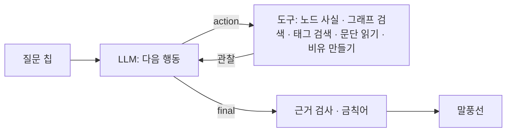
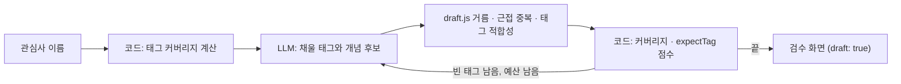
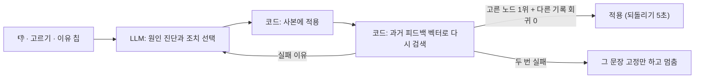
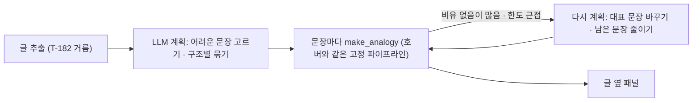

# 0017 제품 안 에이전트 네 가지: 호버는 고정 파이프라인으로 두고, 사용자가 부르는 기능만 에이전트로

- 상태: **결정 (2026-11-28, 사용자)**. 방향 채택, 아래 "열린 결정"에 답을 적었다. 첫 구현은 T-216(이어 묻기).

## 배경

D-6(2026-10-17 사용자 질문 "에이전트 단에 대한 구현 설계 되어 있니?")은 세 갈래로 정리돼 있었다. (1) 오프라인 에이전트(밈 조사·패치 반영·검수 리포트·관심사 초안), (2) 호버 경로 에이전트화(비추천), (3) 개발용 Claude Code 에이전트. 추천은 "호버는 고정 파이프라인 유지, 에이전트는 (1)의 오프라인 작업에만"이었다.

이 문서는 네 번째 방향을 제안한다. **제품 안에서, 호버 다음에, 사용자가 직접 부를 때만 도는 에이전트**다. (1)의 오프라인 작업을 에이전트로 감싸는 일은 확장을 쓰는 사람에게 달라지는 것이 없어서 뒤로 미룬다. 공통 그래프 노드 추가는 이미 자동 검사와 회귀 관문이 있는 고정 흐름(T-194, `tools/node-pipeline/`)이고 사람 승인으로 끝난다.

## 고정 파이프라인과 에이전트를 나누는 기준

- 할 일이 미리 정해져 있으면 고정 파이프라인으로 둔다.
- 입력에 따라 할 일이 달라지고, 앞 단계 결과를 보고 다음 단계를 정해야 하면 에이전트로 만든다.

**호버는 고정 파이프라인으로 둔다.** 할 일이 정해져 있고, 이미 3.6~9.1초가 걸린다. 정밀 모드가 LLM 2회로 질의 추상화와 태그 판정을 하고 있다(ADR 0014, 메이플 홀드아웃 21/32 → 28~29/32). 여기에 루프를 넣으면 지연과 무료 한도 소모만 늘어난다. D-6 (2)와 같은 결론이다.

**에이전트는 호버 다음에 둔다.** 사용자가 버튼이나 질문으로 부를 때만 돈다. 사용자가 더 알고 싶어서 누른 것이라 몇 초 더 기다릴 이유가 있다.

## 공통 설계

### 루프와 액션 형식: JSON 액션 ReAct

매 단계 LLM은 다음 둘 중 하나만 답한다.

```json
{ "action": "<도구 이름>", "args": { } }
{ "final": { } }
```

도구 결과를 관찰로 붙여 다음 단계를 부르고, `final`이 나오거나 상한에 닿으면 끝난다.

제공자 고유 function calling 대신 JSON 액션을 쓰는 이유:
- `providers.js` `complete()`는 제공자 공통 텍스트 호출이다. fallback 체인(ADR 0008)은 순위가 계속 붙는다(규칙 7).
- 제공자마다 도구 호출 형식이 다르다. 고유 형식을 쓰면 호출 로직이 제공자별로 흩어지고, 체인 중간에 다른 제공자로 넘어갈 때 대화 형식이 바뀐다.
- 체인 맨 뒤 로컬 Ollama 모델(규칙 8)의 도구 호출 지원은 확인되지 않았다.

답은 `parseJSONLoose`로 읽는다. 형식이 틀리면 한 번 다시 묻고, 그래도 틀리면 멈춘다.

버린 대안:
- **제공자 고유 function calling:** 위 이유. 특정 모델에서 형식 오류가 잦으면 그 제공자 `KINDS`에만 선택 사항으로 더한다.
- **LangGraph 같은 에이전트 프레임워크:** 번들이 커지고, 루프가 짧아서 직접 둔 상태 머신이 가짜 LLM 테스트로 검증하기 쉽다.

### 모듈

| 파일 | 하는 일 |
| --- | --- |
| `extension/lib/agent.js` | 루프, 단계·호출 상한, 반복 감지, 실행 기록(`debug.trace`). chrome.*를 쓰지 않는 순수 함수다. `runAnalogy`처럼 LLM 호출(`ask`)과 도구를 주입받는다 |
| `extension/lib/agent-tools.js` | 도구 정의. 대부분 기존 함수를 감싼다 |

에이전트 네 개는 도구 묶음, 시스템 프롬프트, 끝 조건만 다르다.

### 도구

| 도구 | 감싸는 것 | 쓰는 에이전트 |
| --- | --- | --- |
| `search_graph(text, exclude)` | 한 문장 임베딩(`embedEach`) + `retrieve()` | 1·2·4 |
| `search_by_tag(tagId, exclude)` | 병합 그래프에서 그 태그를 가진 노드 | 1·2 |
| `get_node_facts(nodeId)` | `mergeGraphs` 결과의 노드 사실·태그·엣지 | 1·3 |
| `read_page_context(range)` | content.js 문단 추출. 입력칸·코드·비밀번호 폼 글자를 빼는 거름(T-182) 그대로 | 1·4 |
| `make_analogy(sentence, candidates)` | `runAnalogy`(규칙 1 검증·근거 검사 포함). 호버와 같은 고정 파이프라인 | 1·4 |
| `tag_coverage()` | 태그별 노드 수 | 2 |
| `draft_nodes(tagId, n)` | T-301 초안 + `draft.js` 거름 | 2 |
| `score_by_tag(graph)` | 평가 문장의 `expectTag`로 1위 노드 태그 적중 | 2 |
| `try_fix(kind, args)` · `verify_history()` | 피드백 층·내 태그 예문(`corrections.js`)을 사본에 적용하고, 과거 피드백 기록의 문장 벡터로 다시 검색 | 3 |

### 권한

- 읽기 도구는 자유롭게 쓴다.
- 쓰기는 세 곳만 된다.
  - 그 사용자의 피드백 층(규칙 3 예외, ADR 0010)
  - 내 그래프 태그 예문(로그인일 때만, `corrections.js` 거름)
  - 초안 노드(`draft: true`). 사용자가 사실을 모두 확인하기 전에는 `mergeGraphs`가 검색 근거에서 뺀다(T-301).
- 공통 그래프, `tags.json`, 평가 파일, 금칙어 파일은 어떤 도구로도 쓸 수 없다(규칙 3·9·11). 에이전트가 자기를 재는 평가 파일을 고칠 수 있으면 평가가 의미를 잃는다.

### 근거와 안전

- 사용자에게 보이는 최종 답은 모두 `checkGrounding`과 금칙어 거름(`applyBlocklist`)을 지난다(규칙 1·11). 걸린 문장은 숨기고 이유를 보인다(기존 문구를 그대로 쓴다).
- 페이지 글은 사용자가 부른 기능에서만, 정한 범위만 보낸다(열린 결정 1).

### 상한과 실패 처리

- 실행마다 단계 상한과 LLM 호출 상한을 둔다(에이전트별 값은 아래). 같은 도구를 같은 인자로 두 번 부르면 멈춘다.
- 429는 기존 쿨다운과 체인을 그대로 쓴다(ADR 0008). 체인이 다 막히면 지금까지 얻은 결과와 "여기까지 했어요"를 보이고 멈춘다.
- MV3 서비스 워커는 오래 쉬면 내려갈 수 있다. 오래 걸리는 2·4번은 단계마다 상태를 `chrome.storage.session`에 저장하고 이어 간다.
- 단계별 도구, 인자 요약, 지연을 `debug.trace`에 남긴다. 평가 도구가 같은 기록을 읽는다.

## 1. 말풍선 이어 묻기

- **기능:** 호버 말풍선 아래에 질문 칩 세 개("왜 비슷해요?", "이 문단은요?", "다른 비유는요?")를 둔다. 자유 입력칸은 선택 사항이다. 칩을 누르면 에이전트가 질문에 맞는 도구를 골라 답한다.
- **목적:** 한 줄 비유로는 왜 그 개념인지 납득이 안 되거나, 문단 전체 맥락이 필요할 때 할 수 있는 일이 없다. 지금은 👎로 다른 비유를 받는 것까지만 된다.
- **기대 효과:**
  - 비유를 납득하는 경로가 생긴다.
  - "틀렸다"(👎)와 "이해가 안 된다"가 구분돼, 피드백 기록에 덜 섞인다.
  - 이어 묻기를 쓴 뒤의 👎 비율로 효과를 확인한다.
- **구조:**



- **설계 방식:** ReAct(JSON 액션). 질문 종류를 미리 알 수 없고 단계가 1~3번으로 짧다.
  - "왜 비슷해요?": `get_node_facts` 한 번이면 끝난다.
  - "다른 비유는요?": 쓴 노드를 빼고 `search_graph`를 부른다. 맞는 후보가 없으면 `search_by_tag`로 넘어가고, 그래도 없으면 "없다"고 답한다.
  - Plan-and-Execute는 계획 호출이 한 번 더 들어서, 짧은 질문에는 지연만 늘어난다.
- **상한:** 4단계, LLM 4회.
- **재는 방법:**
  - 평가 문장 일부에 이어 묻기 질문을 붙인 셋을 결과를 보기 전에 커밋한다.
  - `eval:gen --judge`처럼 생성과 다른 계열의 채점 모델로 근거 준수와 답 적합성을 잰다.
  - 도구 호출 수, 지연, 근거 위반 수를 같이 본다.

### 구현 메모 (T-216, 2026-11-28)

- `extension/lib/agent.js`(루프)·`extension/lib/agent-tools.js`(도구·에이전트 1)·background `agent:ask`·content.js 말풍선 `이어 묻기`.
- 칩은 "왜 비슷해요?"·"다른 비유는요?" 둘과 자유 입력칸이다. "이 문단은요?"는 열린 결정 1(문단 전송 보류)로 뺐다. 보내는 글은 호버와 같은 문장·단어·앞 문장·제목과 방금 결과(뜻·비유·근거·후보 id)뿐이다.
- 입력칸은 `이어 묻기` 버튼을 눌러야 열린다. 말풍선이 매번 커지지 않게 하고, 피드백 UI의 "글자 입력 없음"(T-106)은 그대로 둔다.
- 도구는 `get_node_facts`·`search_graph`·`search_by_tag` 셋, 모두 읽기 전용이다. `read_page_context`는 문단 전송 보류로, `make_analogy`는 중첩 LLM 호출이 상한(4회)을 먹어서 빼 두었다(필요해지면 4번 에이전트와 함께 더한다). 이어 묻기는 쓰기 권한이 없다.
- 규칙 1의 "후보"는 호버 후보 id(그래프에 있는 것만) ∪ 이번 실행에서 도구가 돌려준 노드다. 사실은 늘 그래프 노드에서 읽는다(콘텐츠 스크립트·LLM이 준 사실을 믿지 않는다). 그 밖의 nodeId는 기존 문구(`REJECTED_TEXT`)로 숨긴다. 노드 없이 답하면(맞는 개념 없음) facts가 비어 usedFact를 대면 숨기고, 숫자는 원문·앞 문장에 있어야 한다.
- 근거 검사(`checkGrounding`)와 금칙어(`applyBlocklist`)는 답 글을 비유 필드로 보고 그대로 쓴다. 끝맺음 교정(T-122) 재호출은 하지 않는다(호출 상한 안에서 프롬프트 규칙만).
- 하루 상한: admin `agent.dailyCallCap`(기본 40, 질문 하나에 보통 2회), 정책으로도 줄 수 있다(`managed_schema.json`). LLM 호출마다 차감하고, 닿으면 그 자리에서 멈춘다. 이 기기 `chrome.storage.local` `agentCalls = { day, count }`, 날이 바뀌면 처음부터. 호버 체인의 429 쿨다운은 같이 쓴다(같은 제공자 한도라서).
- 멈춤(상한·반복·형식·체인 소진)은 "여기까지 했어요." + 이유 + 살펴본 개념 이름을 보인다. 이어 묻기는 짧아서 단계 상태를 `chrome.storage.session`에 저장하지 않고 `keepAlive`로 감싼다(저장·이어 가기는 오래 걸리는 2·4번 몫).
- 데모 제공자면 LLM 없이 "데모 모드에서는 이어 묻기를 쓸 수 없어요."
- 측정(이어 묻기 질문셋 + 다른 계열 채점)은 T-218에서 더했다(아래).

### 측정 메모 (T-218, 2026-11-28)

- **측정셋** `tools/eval-followup.json` 20문항(평가셋 문장 + "왜 비슷해요?"·"다른 비유는요?"·자유 질문). 문항마다 기대 `node`(개념으로 답)·`none`(맞는 개념 없음, 5문항)·`any`, "다른 비유"는 `notPrev`(방금 근거와 다른 개념). 결과를 보기 전에 커밋했다.
- **실행** `npm run eval:followup`(`tools/eval-followup.mjs`·`eval-followup-lib.mjs`). 호버와 같은 `runAnalogy`로 방금 결과·후보를 만들고, 확장과 같은 `runFollowup`을 Node에서 돈다. 검색은 기본이 실제 확장(크롬) 임베딩, `--fallback`은 대체 임베더. 채점은 생성과 다른 **계열**(제공자) 모델(기본 NVIDIA)이고, 채점 계열은 생성 체인에서 뺀다. 채점은 근거 검사로 걸러지기 **전** 답을 본다(모델 행동을 재려고). 코드 지표: 규칙 1·근거 검사 숨김, 기대 지킴, 응답마다 JSON 액션·도구 이름·인자, 호출·단계, 지연(분당 간격 기다림은 뺌). 호버·이어 묻기·채점 결과는 `.tmp/eval-followup-cache.json`에 캐시, `--max-calls`로 생성 호출 상한.
- **스모크** `npm run smoke:providers -- --agent`(워크플로 입력 `agent`). 고정 4과제를 고정 prev(LLM 없이)로 보내 형식만 본다. 형식을 어겨도 확장은 "여기까지 했어요"로 멈출 뿐이라 실패로 세지 않는다(`--precise-judge`와 같은 방식).
- **👎 비율** 이어 묻기 답을 본 말풍선에서 누른 피드백은 `afterAgent: true`로 기록하고, 보인 답 수를 `chrome.storage.local` `agentAnswerCounts`(날짜별 14일)로 센다. "내 피드백" 두 번째 줄에 7일 창으로 "이어 묻기 답 N번 뒤 👎 k (x%) · 호버 M번 뒤 👎 j (y%)". 기기 안 집계, 새 권한 없음. 👎는 호버 비유에 대한 것이라, 이 비율은 "이어 묻기가 납득을 도왔나"의 간접 지표다.
- **첫 결과(Gemini `gemini-3.5-flash-lite`, 11문항, 실제 확장 검색)**: 형식은 문제없음(JSON 21/21, 도구·인자 10/10, 호출 평균 1.9, 지연 중앙 1.7초). 그러나 **보인 답 6/11**: 근거 검사가 5개를 숨겼다. 모델이 `get_node_facts` 없이 바로 final을 내며 usedFact를 지어 쓴다(시스템 프롬프트는 후보 사실을 싣지 않는다). **"없음" 기대 0/3**: 맞는 개념이 없어도 억지 비유를 낸다. 규칙 1 숨김 0. 채점 모델은 억지 비유에도 도움됨 4~5를 주는 경우가 있어 "없음" 판정은 코드 지표(기대 지킴)를 우선 본다.
- **다음**: 프롬프트 보강(사실은 도구 결과로만, usedFact는 그 결과 글자 그대로, final 전 `get_node_facts` 필수 또는 후보 사실 일부를 시작 프롬프트에 싣기, 없음 기준 예시)과 채점 기준 보강은 별도 작업으로 잰다. Groq 형식 확인은 Actions 스모크(`agent: true`)로. → T-222(아래 품질 메모)

### 품질 메모 (T-222, 2026-11-28)

T-218 측정의 두 문제(사실을 읽지 않고 인용 → 근거 검사로 숨김, "맞는 개념 없음"에서 억지 비유)와 Actions 스모크의 Groq 형식 문제를 고쳤다. 숫자는 `docs/EVAL_LOG.md` T-222 세 줄.

- **프롬프트**(`buildFollowupPrompt`, 판 `FOLLOWUP_PROMPT_VERSION`): 개념으로 답하려면 먼저 facts를 도구로 읽는다, usedFact는 도구 결과 facts 문장을 글자 그대로 복사한다(개념 이름은 사실이 아님), facts에 없는 수치는 모른다고 답한다. "없음" 기준은 핵심 구조(제한·증폭·교환·조건)가 facts와 구체적으로 같을 때만 비유하고, 두루뭉술한 공통점("정해진 조건", "과정")은 맞는 개념이 아니라고 적었다. 예시(날짜·장소 안내, 성질 묘사, 생활 수칙, 단순 행동 / 기다림 제한, 잃을 위험, 풀릴수록 떨어지는 값)는 관심사와 상관없는 구조로 써서 식당 관심사에도 그대로 쓴다. "함수 호출 기능은 쓰지 않는다"도 넣었다.
- **루프에서 강제**(`followupProblems` + `runAgent` `verify`): final이 개념을 댔는데 이번 실행에서 그 facts를 읽지 않았거나(도구 셋 모두 facts를 돌려주므로 셋 중 무엇이든 읽은 것), 근거 검사(fact-mismatch·number-outside)에 지거나, usedFact가 비었거나, 후보 밖 개념이거나, 개념 없이 usedFact를 댔거나, 해요체가 아니면 **그 개념의 facts를 실어 한 번만 되묻는다**(`FOLLOWUP_MAX_CORRECTIONS = 1`). facts를 실어 주므로 다시 도구를 부르지 않아도 되어 호출 1회로 끝난다. 두 번째 final은 그대로 `finalizeAnswer`가 판정한다. **규칙 1·근거 검사·금칙어 숨김은 하나도 빼지 않았다**(되묻기는 그 앞의 교정 문구일 뿐). 남은 단계·호출이 없으면 되묻지 않는다(`verify(final, { stepsLeft, callsLeft })`, 되묻다 상한에 닿아 답을 잃지 않게).
- **루프 공통**(`agent.js`, 교정 진단에도 적용): 같은 도구·같은 인자 반복은 한 번은 "[반복]" 관찰로 알리고 두 번째에 멈춘다(`maxRepeats = 1`, Nemotron이 사실을 읽은 뒤 같은 확인을 한 번 더 부르는 일이 잦았다). 남은 차례가 하나면 "[마지막 차례]" 문구로 final을 청한다. `parseAction`은 실제로 본 변형만 더 받는다: `{"action":"final","args":{"final":…}}`(NVIDIA), 감싸기 없는 `{answer,nodeId,usedFact}`(Groq), `{name, arguments}`(고유 함수 호출 모양), args 없이 펼친 인자, 객체 둘을 이어 붙인 글(`parseJSONLoose`의 마지막 단계로 첫 균형 객체, 앞의 두 단계가 실패할 때만이라 호버 해석은 그대로).
- **Groq 형식**(원문 진단: 스모크가 형식이 틀린 응답의 앞 240자를 보인다): gpt-oss는 도구 목록을 보면 고유 함수 호출(Harmony)을 낸다 — 빈 content, `400 Tool choice is none, but model called a tool`, 없는 도구(`repo_browser.search_code`). 고친 것은 제공자 공통 경로 한 곳(`providers.js` openai-compat, 규칙 7): 에이전트 호출만 `jsonObject`를 청하고 등록부가 `jsonObject: true`인 제공자(지금 Groq)에만 `response_format: json_object`를 보낸다(호버는 그대로), content 없이 `tool_calls`가 오면 JSON 액션 글자로 바꾼다, 모델 출력 400(`tool_use_failed`·JSON 검증 실패)은 `failed_generation`이 있으면 그 글을 답으로 쓰고 없으면 한 번 다시 보내며(JSON 객체 모드는 끄고), 그래도 실패하면 `modelOutput`으로 표시해 fallback 체인이 다음 순서로 넘긴다(키 오류 400은 그대로 던짐, 쿨다운 없음). 결과 Groq 최종 답 2/4 → 4/4, JSON 액션 2/7 → 6/9, 그러나 스스로 facts를 읽는 도구 호출은 0회라 되묻기에 기대 답을 맞춘다.
- **판정: 에이전트만 다른 순서**(`admin.json` `agent.providerOrder`, 정책으로도). 형식 고침 뒤에도 Groq는 도구를 쓰지 않고 후보 이름만 보고 답해, 같은 스모크에서 Gemini(JSON 8/8, 도구를 부르고 없음을 바로 말함)·NVIDIA(9/9·4/4)보다 이어 묻기에 맞지 않는다. 지연은 Gemini가 0.9~2초로 이어 묻기(사용자가 눌러서 기다리는 기능)에 충분하다. 그래서 순서는 gemini → nvidia → groq. 구현은 `fallback.js` `reorderChain`: **체인에 이미 있는 항목끼리 자리만 바꾼다** — 목록에 있는 제공자가 차지한 자리를 목록 순서로 다시 채우고, 목록에 없는 항목(사용자가 고른 다른 제공자 등)은 제자리, 로컬(`def.local`)은 목록에 있어도 움직이지 않아 늘 맨 뒤다(규칙 8). 항목을 더하거나 빼지 않으므로 순위가 더 붙어도 그대로 된다(규칙 7). 호버 체인은 바뀌지 않는다. 비우면 호버와 같은 순서다.
- **채점**(`eval-followup-lib.mjs`, 판 `JUDGE_VERSION`): `forced`(억지 비유) 항목을 더하고, 억지면 도움됨 1~2, 날짜·장소 안내·성질 묘사·생활 수칙·단순 행동 문장에 붙인 비유는 거의 항상 억지라고 적었다. 요약에 억지 비유 수(보인 답 기준 따로). 같은 기준으로 고치기 전 답을 다시 채점해 비교했다(도움됨 3.70·억지 5/20 → 4.20·0/20).
- **결과**(Gemini 생성, 실제 확장 검색, 20문항): 보인 답 13/20 → **20/20**, 없음 1/5 → **5/5**, 개념 6/9 → 9/9, 규칙 1 숨김 0 → 0, 근거 준수 100% 유지, 지연 중앙 1.6 → 1.9초.
- **남은 것**: 되묻기 뒤 답이 또 ~습니다로 끝나면 그대로 보인다(T-216 결정대로 끝맺음 교정 재호출 없음, NVIDIA 스모크 한 건). Groq가 스스로 facts를 읽게 하는 일은 하지 않았다(순서를 뒤로 뺐으므로).

## 2. 새 관심사 만들기 도우미

- **기능:** 사용자가 관심사 이름(예: 축구)을 넣으면 개념 초안을 만든다. 22개 태그 중 비어 있는 태그를 찾아 그 구조에 맞는 개념을 더 찾고, 시험해 본 뒤 검수 화면에 올린다.
- **목적:** 기본 관심사는 메이플과 식당 둘뿐이다. T-301은 한 번 호출로 초안 10~20개를 만들고, 어느 태그가 비었는지는 보지 않는다. 비유가 붙는 문장의 폭은 태그를 얼마나 덮었는지에 달려 있다.
- **기대 효과:** 같은 초안 상한(20개) 안에서 태그를 더 넓게 덮는 그래프가 나오고, 다양한 문장에 비유가 붙는다. 사용자가 검수할 양은 지금과 같다.
- **구조:**



- **설계 방식:** Plan-and-Execute에 평가자-개선자 루프를 붙인다.
  - 어느 태그가 비었는지 계산하는 일과 거름·점수 매기기는 코드가 한다.
  - LLM은 빈 태그를 채울 개념을 찾고, "이 관심사에는 이 구조가 없다"고 판단해 그 태그를 포기하는 일을 맡는다.
  - 자율 ReAct로 두지 않는 이유: 목표(태그 커버리지)와 평가가 숫자로 정해져 있어서, 코드가 순서를 쥐는 편이 결과를 예측하기 쉽고 호출 수를 통제하기 쉽다.
- **상한:** 초안 최대 20개(`DRAFT_LIMITS.max`), LLM 12회. 같은 태그에서 두 번 실패하면 그 태그는 "이 관심사에 없음"으로 표시한다.
- **재는 방법:**
  - 태그가 분야와 상관없이 정의돼 있어서, 기존 평가 문장의 `expectTag`로 새 그래프를 잴 수 있다. 새 그래프에서 1위 노드가 `expectTag`를 가진 비율을 본다.
  - 노드 단위 정답은 없다. 샘플 관심사 몇 개로 T-301 한 번 호출 초안과 비교한다.
  - 검수에서 사용자가 지운 사실의 비율도 기록한다.
- **공통 그래프 노드 파이프라인과의 차이:** 사용자 자신의 그래프에만 쓰고, 출처 정책(ADR 0016) 대신 사용자 검수를 거친다(열린 결정 3).

## 3. 👎 교정 진단

- **기능:** 👎, "더 맞는 개념" 선택, 이유 칩(`forced`·`meaning`·`fact`·`none`)을 받아 원인을 진단한다. 그 사용자 범위에서 고쳐 본 뒤, 과거 피드백으로 회귀가 없는지 확인하고 적용한다.
- **목적:** 지금 피드백은 기록 종류에 따라 정해진 조치가 돈다.
  - 그 문장의 제외·고정(T-129)
  - 비슷한 문장 가점·감점(T-130)
  - 교정 예문(T-131)

  하지만 틀린 원인(태그 예문 부족, 맞는 노드 없음, 문장 뜻을 잘못 읽음)에 따라 맞는 조치가 다르다. 그리고 조치가 그 사용자의 다른 문장 결과를 바꾸는지 확인하지 않는다.
- **기대 효과:** 쓸수록 그 사용자에게 맞아지고, 조치가 다른 문장을 망가뜨리지 않았다는 확인이 붙는다.
- **구조:**



- **조치 목록:** 다음 중에서 고른다.
  - 내 태그에 예문 추가: 로그인 상태이고 내 그래프일 때만. 공통 그래프면 지금처럼 운영자 큐로 보낸다.
  - 그 문장 고정만
  - 맞는 노드가 없음: 2번 도우미나 노드 만들기를 제안한다.
  - 뜻을 잘못 읽음: 정밀 모드로 다시 비유를 만든다.

  피드백은 후보 제외·고정과 기존 태그 예문 추가까지만 할 수 있다. 새 사실과 새 태그는 만들지 않는다(규칙 3, ADR 0010 원칙 6).
- **설계 방식:** 검증기가 붙은 루프(Reflexion식). LLM은 진단과 조치 선택만 하고, 적용과 검증은 코드가 한다. 실패 이유는 다음 시도의 입력으로 넣는다.
  - 도구를 자유롭게 주는 ReAct로 두지 않는 이유: 쓰기 동작이라, 조치를 정해진 몇 가지로 묶어야 되돌리기와 회귀 확인을 할 수 있다.
  - 과거 기록의 문장 벡터는 이미 저장돼 있다(T-130 `vec`).
- **상한:** LLM 3회, 조치 시도 2회.
- **재는 방법:** 저장된 피드백 기록을 다시 돌려서 아래를 본다.
  - 조치 뒤 그 문장 1위가 고른 노드가 된 비율
  - 다른 기록의 1위가 바뀐 수(목표 0)
  - 사용자가 되돌리기를 누른 비율

### 구현 메모 (T-220, 2026-11-28)

위 설계(조치 선택 → 사본 적용 → 과거 피드백으로 회귀 확인)에서 첫 구현은 범위를 줄였다. **진단 + 다른 후보로 다시 비유 + 검증기**까지이고, 회귀 확인(`verify_history`)·`try_fix`는 뒤로 미룬다(측정셋과 함께 후속 작업).

- 흐름: 👎 → 지금처럼 빠른 다시 비유(ADR 0010, 기본 경로를 늦추지 않는다) → 말풍선에 `왜 틀렸는지 살펴볼게요`(opt-in) → background `agent:diagnose`.
- 모듈: `extension/lib/agent-diagnose.js`. 루프는 `agent.js` `runAgent`를 그대로 쓰고, 선택 `verify` 훅만 더했다(final이 지면 "[검증 실패] 이유"를 관찰로 붙여 다시 묻고, `maxVerifies`번 지면 `stop: 'verify'`). 루프를 복제하지 않았다.
- 원인은 7개 고정 목록(`structure`·`tag`·`facts`·`tone`·`number`·`meaning`·`none`)이고 말풍선에는 고정 문구 한 줄만 보인다(LLM 글을 진단 줄에 싣지 않는다). 원래 결과 기록(근거 검사 이유·끝맺음·근거 개념 태그 유사도·1·2위 점수 차·이유 칩)에서 코드가 먼저 단서를 뽑아 프롬프트에 넣는다.
- 도구는 이어 묻기의 읽기 전용 셋(`get_node_facts`·`search_graph`·`search_by_tag`). 검증기: 👎한 개념 금지 → 규칙 1(원래 후보 ∪ 이번 실행 도구 결과 노드) → 근거 검사 → 금칙어 → 해요체 끝맺음. 상한 5단계·LLM 4회·검증 2회, 하루 상한은 이어 묻기와 같은 `agent.dailyCallCap`(`agentCalls`)을 함께 센다.
- 쓰기: 에이전트는 쓰지 않는다. 새 비유 밑 버튼을 사용자가 눌러야 background `agent:diagnose-apply`가 쓴다. "이 비유로 고정" = 피드백 층 pick(로그아웃도 됨, 규칙 3 예외). 로그인 + 내 노드 + 내 태그(공통 태그 id 아님)이고 `corrections.js` 거름을 지나면 "고정하고 예문으로 넣기"(가린 문장 미리보기)로 바뀌고, 같은 pick 기록을 기존 `syncCorrections`가 내 태그 examples에 반영한다. 제안은 background에서 다시 계산해 콘텐츠 스크립트 값을 믿지 않는다. 공통 노드 pick은 지금처럼 운영자 내보내기로만 간다.
- 보내는 글은 호버와 같은 범위 + 👎한 결과 기록(후보 id·점수·태그·근거 검사·끝맺음)과 다시 만든 비유뿐이다(열린 결정 1 보류).
- 측정(저장된 피드백 기록 재생: 1위가 고른 노드가 된 비율, 다른 기록 1위 변화 수)은 아직 없다.

## 4. 이 글 풀어 주기

- **기능:** 팝업이나 말풍선 버튼으로 지금 글 전체를 받는다. 어려운 문장을 고르고, 문장마다 비유를 만들고, 같은 구조인 문장은 묶어 글 옆 패널에 보여 준다. 비유가 없는 문장은 쉬운 뜻만 보여 준다.
- **목적:** 긴 글은 문장마다 Alt를 누르고 호버해야 한다. 어디가 어려운지 모를 때는 어디서 시작할지도 알 수 없다.
- **기대 효과:** 글 한 편을 단위로 이해할 수 있고, 호버 횟수가 줄어든다.
- **구조:**



- **설계 방식:** Plan-and-Execute(오케스트레이터와 워커).
  - 계획은 글 전체를 봐야 하고, 실행 단계는 문장끼리 서로 독립이라 계획한 뒤 실행하는 구조가 맞는다.
  - 실행은 호버와 같은 고정 파이프라인(`runAnalogy`)을 다시 쓰므로, 문장 하나하나의 품질은 기존 평가가 보증한다.
  - 1번에서 만든 도구를 그대로 쓴다.
- **상한:** 문장 8개, LLM 호출은 계획 1회 + 문장당 1~2회(정밀 모드) + 다시 계획 1회.
- **재는 방법:**
  - 문장 단위 비유는 기존 생성 평가와 같은 방법으로 잰다.
  - 어려운 문장 고르기에는 정답셋이 없다. 사람이 어려운 문장을 표시한 글 몇 편을 먼저 커밋하고 재현율을 잰다.
  - 글 한 편당 호출 수와 시간도 본다.

## 우선순위

각 항목 1~5점이고 높을수록 좋다. 제품 가치와 에이전트 필요도는 2배로 친다. 만점은 35점이다.

**기준:**
- **제품 가치:** 실사용자가 없어서 추정치다.
- **에이전트 필요도:** 단계가 여럿인지, 결과에 따라 분기하는지, 상태가 있는지, 실패를 처리해야 하는지 네 가지 중 해당하는 수로 매긴다.
- **측정:** 기존 평가 도구로 잴 수 있는지
- **구현 크기:** 일이 클수록 낮다.
- **위험:** 지연, 무료 한도, 개인정보 부담이 클수록 낮다.

| # | 에이전트 | 제품 가치 ×2 | 에이전트 필요도 ×2 | 측정 | 구현 크기 | 위험 | 합계 |
| --- | --- | --- | --- | --- | --- | --- | --- |
| 1 | 말풍선 이어 묻기 | 4 | 5 | 4 | 4 | 3 | 29 |
| 2 | 새 관심사 만들기 도우미 | 5 | 4 | 3 | 3 | 2 | 26 |
| 3 | 👎 교정 진단 | 3 | 4 | 4 | 3 | 4 | 25 |
| 4 | 이 글 풀어 주기 | 4 | 5 | 3 | 2 | 2 | 25 |

**제안 순서는 1 → 4 → 3 → 2다.**
- 4는 1의 도구와 `agent.js`를 그대로 쓴다.
- 3은 1·4와 상관없어서 언제든 할 수 있다.
- 2는 제품 가치가 가장 크지만, 사실 근거를 어떻게 할지(열린 결정 3)를 먼저 정해야 한다.

## 열린 결정 → 사용자 답 (2026-11-28)

- 1(페이지 글 전송 범위): **보류.** 지금은 호버와 같은 범위(문장·단어·앞 문장)만 보낸다. 그래서 4번(이 글 풀어 주기)도 보류. 사용자 메모: "사용자당 하루 5회, 추가 이용은 닫고 나중에 과금 체계" 같은 방식이 떠오르지만 지금은 생각하지 않고 보류.
- 2(무료 한도 배분): **에이전트용 하루 호출 상한을 따로 둔다.** 호버 체인 한도와 섞지 않는다.
- 3(새 관심사 사실 근거): **사용자 검수만**(T-301과 같음), 출처 URL은 있으면 남긴다.
- 4(D-6 답): **이 방향으로 간다.** 순서 1 → 3 → 2(4는 1번 결정 보류로 뒤로).

원래 질문:

1. **페이지 글 전송 범위(1·4):** 지금은 문장, 단어, 앞 문장만 보낸다. 사용자가 이어 묻기나 이 글 풀어 주기를 눌렀을 때 문단(1)이나 글 전체(4)를 보낼지 정해야 한다. 보낸다면 T-182 거름은 그대로 쓴다.
2. **무료 한도 배분:** 에이전트가 호버와 같은 체인과 쿨다운을 쓰면 호버 한도를 먹는다. 에이전트용 하루 호출 상한을 따로 둘지 정해야 한다.
3. **새 관심사(2)의 사실 근거:** 사용자 관심사에는 공식 출처가 없을 수 있다. 지금 T-301처럼 사용자 검수만으로 둘지, 출처 URL을 요구할지 정해야 한다.
4. **D-6 답:** 이 방향으로 갈지 정해야 한다. 정하면 구현 작업 번호를 매기고, 1번부터 `/test-first`로 시작한다.

## 하지 않는 것

- **호버 경로 에이전트화:** D-6 (2)와 같은 결론이다.
- **공통 그래프를 고치는 에이전트:** 노드 추가는 지금의 고정 흐름과 사람 승인을 그대로 쓴다.
- **제공자 고유 function calling 형식:** 위 "루프와 액션 형식"에 적은 이유 때문이다.
