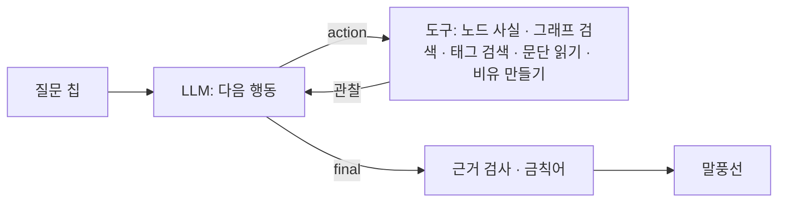
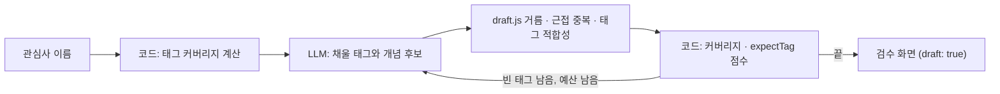
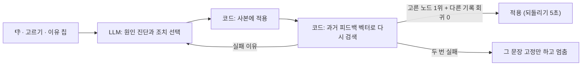
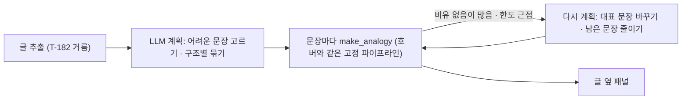

# 0017 제품 안 에이전트 네 가지: 호버는 고정 파이프라인으로 두고, 사용자가 부르는 기능만 에이전트로

- 상태: **결정 (2026-11-28, 사용자)**. 방향 채택, 아래 "열린 결정"에 답을 적었다. 첫 구현은 T-216(이어 묻기).

## 배경

D-6(2026-10-17 사용자 질문 "에이전트 단에 대한 구현 설계 되어 있니?")은 세 갈래로 정리돼 있었다. (1) 오프라인 에이전트(밈 조사·패치 반영·검수 리포트·관심사 초안), (2) 호버 경로 에이전트화(비추천), (3) 개발용 Claude Code 에이전트. 추천은 "호버는 고정 파이프라인 유지, 에이전트는 (1)의 오프라인 작업에만"이었다.

이 문서는 네 번째 방향을 제안한다. **제품 안에서, 호버 다음에, 사용자가 직접 부를 때만 도는 에이전트**다. (1)의 오프라인 작업을 에이전트로 감싸는 일은 확장을 쓰는 사람에게 달라지는 것이 없어서 뒤로 미룬다. 공통 그래프 노드 추가는 이미 자동 검사와 회귀 관문이 있는 고정 흐름(T-194, `tools/node-pipeline/`)이고 사람 승인으로 끝난다.

## 고정 파이프라인과 에이전트를 나누는 기준

- 할 일이 미리 정해져 있으면 고정 파이프라인으로 둔다.
- 입력에 따라 할 일이 달라지고, 앞 단계 결과를 보고 다음 단계를 정해야 하면 에이전트로 만든다.

**호버는 고정 파이프라인으로 둔다.** 할 일이 정해져 있고, 이미 3.6~9.1초가 걸린다. 정밀 모드가 LLM 2회로 질의 추상화와 태그 판정을 하고 있다(ADR 0014, 메이플 홀드아웃 21/32 → 28~29/32). 여기에 루프를 넣으면 지연과 무료 한도 소모만 늘어난다. D-6 (2)와 같은 결론이다.

**에이전트는 호버 다음에 둔다.** 사용자가 버튼이나 질문으로 부를 때만 돈다. 사용자가 더 알고 싶어서 누른 것이라 몇 초 더 기다릴 이유가 있다.

## 공통 설계

### 루프와 액션 형식: JSON 액션 ReAct

매 단계 LLM은 다음 둘 중 하나만 답한다.

```json
{ "action": "<도구 이름>", "args": { } }
{ "final": { } }
```

도구 결과를 관찰로 붙여 다음 단계를 부르고, `final`이 나오거나 상한에 닿으면 끝난다.

제공자 고유 function calling 대신 JSON 액션을 쓰는 이유:
- `providers.js` `complete()`는 제공자 공통 텍스트 호출이다. fallback 체인(ADR 0008)은 순위가 계속 붙는다(규칙 7).
- 제공자마다 도구 호출 형식이 다르다. 고유 형식을 쓰면 호출 로직이 제공자별로 흩어지고, 체인 중간에 다른 제공자로 넘어갈 때 대화 형식이 바뀐다.
- 체인 맨 뒤 로컬 Ollama 모델(규칙 8)의 도구 호출 지원은 확인되지 않았다.

답은 `parseJSONLoose`로 읽는다. 형식이 틀리면 한 번 다시 묻고, 그래도 틀리면 멈춘다.

버린 대안:
- **제공자 고유 function calling:** 위 이유. 특정 모델에서 형식 오류가 잦으면 그 제공자 `KINDS`에만 선택 사항으로 더한다.
- **LangGraph 같은 에이전트 프레임워크:** 번들이 커지고, 루프가 짧아서 직접 둔 상태 머신이 가짜 LLM 테스트로 검증하기 쉽다.

### 모듈

| 파일 | 하는 일 |
| --- | --- |
| `extension/lib/agent.js` | 루프, 단계·호출 상한, 반복 감지, 실행 기록(`debug.trace`). chrome.*를 쓰지 않는 순수 함수다. `runAnalogy`처럼 LLM 호출(`ask`)과 도구를 주입받는다 |
| `extension/lib/agent-tools.js` | 도구 정의. 대부분 기존 함수를 감싼다 |

에이전트 네 개는 도구 묶음, 시스템 프롬프트, 끝 조건만 다르다.

### 도구

| 도구 | 감싸는 것 | 쓰는 에이전트 |
| --- | --- | --- |
| `search_graph(text, exclude)` | 한 문장 임베딩(`embedEach`) + `retrieve()` | 1·2·4 |
| `search_by_tag(tagId, exclude)` | 병합 그래프에서 그 태그를 가진 노드 | 1·2 |
| `get_node_facts(nodeId)` | `mergeGraphs` 결과의 노드 사실·태그·엣지 | 1·3 |
| `read_page_context(range)` | content.js 문단 추출. 입력칸·코드·비밀번호 폼 글자를 빼는 거름(T-182) 그대로 | 1·4 |
| `make_analogy(sentence, candidates)` | `runAnalogy`(규칙 1 검증·근거 검사 포함). 호버와 같은 고정 파이프라인 | 1·4 |
| `tag_coverage()` | 태그별 노드 수 | 2 |
| `draft_nodes(tagId, n)` | T-301 초안 + `draft.js` 거름 | 2 |
| `score_by_tag(graph)` | 평가 문장의 `expectTag`로 1위 노드 태그 적중 | 2 |
| `try_fix(kind, args)` · `verify_history()` | 피드백 층·내 태그 예문(`corrections.js`)을 사본에 적용하고, 과거 피드백 기록의 문장 벡터로 다시 검색 | 3 |

### 권한

- 읽기 도구는 자유롭게 쓴다.
- 쓰기는 세 곳만 된다.
  - 그 사용자의 피드백 층(규칙 3 예외, ADR 0010)
  - 내 그래프 태그 예문(로그인일 때만, `corrections.js` 거름)
  - 초안 노드(`draft: true`). 사용자가 사실을 모두 확인하기 전에는 `mergeGraphs`가 검색 근거에서 뺀다(T-301).
- 공통 그래프, `tags.json`, 평가 파일, 금칙어 파일은 어떤 도구로도 쓸 수 없다(규칙 3·9·11). 에이전트가 자기를 재는 평가 파일을 고칠 수 있으면 평가가 의미를 잃는다.

### 근거와 안전

- 사용자에게 보이는 최종 답은 모두 `checkGrounding`과 금칙어 거름(`applyBlocklist`)을 지난다(규칙 1·11). 걸린 문장은 숨기고 이유를 보인다(기존 문구를 그대로 쓴다).
- 페이지 글은 사용자가 부른 기능에서만, 정한 범위만 보낸다(열린 결정 1).

### 상한과 실패 처리

- 실행마다 단계 상한과 LLM 호출 상한을 둔다(에이전트별 값은 아래). 같은 도구를 같은 인자로 두 번 부르면 멈춘다.
- 429는 기존 쿨다운과 체인을 그대로 쓴다(ADR 0008). 체인이 다 막히면 지금까지 얻은 결과와 "여기까지 했어요"를 보이고 멈춘다.
- MV3 서비스 워커는 오래 쉬면 내려갈 수 있다. 오래 걸리는 2·4번은 단계마다 상태를 `chrome.storage.session`에 저장하고 이어 간다.
- 단계별 도구, 인자 요약, 지연을 `debug.trace`에 남긴다. 평가 도구가 같은 기록을 읽는다.

## 1. 말풍선 이어 묻기

- **기능:** 호버 말풍선 아래에 질문 칩 세 개("왜 비슷해요?", "이 문단은요?", "다른 비유는요?")를 둔다. 자유 입력칸은 선택 사항이다. 칩을 누르면 에이전트가 질문에 맞는 도구를 골라 답한다.
- **목적:** 한 줄 비유로는 왜 그 개념인지 납득이 안 되거나, 문단 전체 맥락이 필요할 때 할 수 있는 일이 없다. 지금은 👎로 다른 비유를 받는 것까지만 된다.
- **기대 효과:**
  - 비유를 납득하는 경로가 생긴다.
  - "틀렸다"(👎)와 "이해가 안 된다"가 구분돼, 피드백 기록에 덜 섞인다.
  - 이어 묻기를 쓴 뒤의 👎 비율로 효과를 확인한다.
- **구조:**



- **설계 방식:** ReAct(JSON 액션). 질문 종류를 미리 알 수 없고 단계가 1~3번으로 짧다.
  - "왜 비슷해요?": `get_node_facts` 한 번이면 끝난다.
  - "다른 비유는요?": 쓴 노드를 빼고 `search_graph`를 부른다. 맞는 후보가 없으면 `search_by_tag`로 넘어가고, 그래도 없으면 "없다"고 답한다.
  - Plan-and-Execute는 계획 호출이 한 번 더 들어서, 짧은 질문에는 지연만 늘어난다.
- **상한:** 4단계, LLM 4회.
- **재는 방법:**
  - 평가 문장 일부에 이어 묻기 질문을 붙인 셋을 결과를 보기 전에 커밋한다.
  - `eval:gen --judge`처럼 생성과 다른 계열의 채점 모델로 근거 준수와 답 적합성을 잰다.
  - 도구 호출 수, 지연, 근거 위반 수를 같이 본다.

## 2. 새 관심사 만들기 도우미

- **기능:** 사용자가 관심사 이름(예: 축구)을 넣으면 개념 초안을 만든다. 22개 태그 중 비어 있는 태그를 찾아 그 구조에 맞는 개념을 더 찾고, 시험해 본 뒤 검수 화면에 올린다.
- **목적:** 기본 관심사는 메이플과 식당 둘뿐이다. T-301은 한 번 호출로 초안 10~20개를 만들고, 어느 태그가 비었는지는 보지 않는다. 비유가 붙는 문장의 폭은 태그를 얼마나 덮었는지에 달려 있다.
- **기대 효과:** 같은 초안 상한(20개) 안에서 태그를 더 넓게 덮는 그래프가 나오고, 다양한 문장에 비유가 붙는다. 사용자가 검수할 양은 지금과 같다.
- **구조:**



- **설계 방식:** Plan-and-Execute에 평가자-개선자 루프를 붙인다.
  - 어느 태그가 비었는지 계산하는 일과 거름·점수 매기기는 코드가 한다.
  - LLM은 빈 태그를 채울 개념을 찾고, "이 관심사에는 이 구조가 없다"고 판단해 그 태그를 포기하는 일을 맡는다.
  - 자율 ReAct로 두지 않는 이유: 목표(태그 커버리지)와 평가가 숫자로 정해져 있어서, 코드가 순서를 쥐는 편이 결과를 예측하기 쉽고 호출 수를 통제하기 쉽다.
- **상한:** 초안 최대 20개(`DRAFT_LIMITS.max`), LLM 12회. 같은 태그에서 두 번 실패하면 그 태그는 "이 관심사에 없음"으로 표시한다.
- **재는 방법:**
  - 태그가 분야와 상관없이 정의돼 있어서, 기존 평가 문장의 `expectTag`로 새 그래프를 잴 수 있다. 새 그래프에서 1위 노드가 `expectTag`를 가진 비율을 본다.
  - 노드 단위 정답은 없다. 샘플 관심사 몇 개로 T-301 한 번 호출 초안과 비교한다.
  - 검수에서 사용자가 지운 사실의 비율도 기록한다.
- **공통 그래프 노드 파이프라인과의 차이:** 사용자 자신의 그래프에만 쓰고, 출처 정책(ADR 0016) 대신 사용자 검수를 거친다(열린 결정 3).

## 3. 👎 교정 진단

- **기능:** 👎, "더 맞는 개념" 선택, 이유 칩(`forced`·`meaning`·`fact`·`none`)을 받아 원인을 진단한다. 그 사용자 범위에서 고쳐 본 뒤, 과거 피드백으로 회귀가 없는지 확인하고 적용한다.
- **목적:** 지금 피드백은 기록 종류에 따라 정해진 조치가 돈다.
  - 그 문장의 제외·고정(T-129)
  - 비슷한 문장 가점·감점(T-130)
  - 교정 예문(T-131)

  하지만 틀린 원인(태그 예문 부족, 맞는 노드 없음, 문장 뜻을 잘못 읽음)에 따라 맞는 조치가 다르다. 그리고 조치가 그 사용자의 다른 문장 결과를 바꾸는지 확인하지 않는다.
- **기대 효과:** 쓸수록 그 사용자에게 맞아지고, 조치가 다른 문장을 망가뜨리지 않았다는 확인이 붙는다.
- **구조:**



- **조치 목록:** 다음 중에서 고른다.
  - 내 태그에 예문 추가: 로그인 상태이고 내 그래프일 때만. 공통 그래프면 지금처럼 운영자 큐로 보낸다.
  - 그 문장 고정만
  - 맞는 노드가 없음: 2번 도우미나 노드 만들기를 제안한다.
  - 뜻을 잘못 읽음: 정밀 모드로 다시 비유를 만든다.

  피드백은 후보 제외·고정과 기존 태그 예문 추가까지만 할 수 있다. 새 사실과 새 태그는 만들지 않는다(규칙 3, ADR 0010 원칙 6).
- **설계 방식:** 검증기가 붙은 루프(Reflexion식). LLM은 진단과 조치 선택만 하고, 적용과 검증은 코드가 한다. 실패 이유는 다음 시도의 입력으로 넣는다.
  - 도구를 자유롭게 주는 ReAct로 두지 않는 이유: 쓰기 동작이라, 조치를 정해진 몇 가지로 묶어야 되돌리기와 회귀 확인을 할 수 있다.
  - 과거 기록의 문장 벡터는 이미 저장돼 있다(T-130 `vec`).
- **상한:** LLM 3회, 조치 시도 2회.
- **재는 방법:** 저장된 피드백 기록을 다시 돌려서 아래를 본다.
  - 조치 뒤 그 문장 1위가 고른 노드가 된 비율
  - 다른 기록의 1위가 바뀐 수(목표 0)
  - 사용자가 되돌리기를 누른 비율

## 4. 이 글 풀어 주기

- **기능:** 팝업이나 말풍선 버튼으로 지금 글 전체를 받는다. 어려운 문장을 고르고, 문장마다 비유를 만들고, 같은 구조인 문장은 묶어 글 옆 패널에 보여 준다. 비유가 없는 문장은 쉬운 뜻만 보여 준다.
- **목적:** 긴 글은 문장마다 Alt를 누르고 호버해야 한다. 어디가 어려운지 모를 때는 어디서 시작할지도 알 수 없다.
- **기대 효과:** 글 한 편을 단위로 이해할 수 있고, 호버 횟수가 줄어든다.
- **구조:**



- **설계 방식:** Plan-and-Execute(오케스트레이터와 워커).
  - 계획은 글 전체를 봐야 하고, 실행 단계는 문장끼리 서로 독립이라 계획한 뒤 실행하는 구조가 맞는다.
  - 실행은 호버와 같은 고정 파이프라인(`runAnalogy`)을 다시 쓰므로, 문장 하나하나의 품질은 기존 평가가 보증한다.
  - 1번에서 만든 도구를 그대로 쓴다.
- **상한:** 문장 8개, LLM 호출은 계획 1회 + 문장당 1~2회(정밀 모드) + 다시 계획 1회.
- **재는 방법:**
  - 문장 단위 비유는 기존 생성 평가와 같은 방법으로 잰다.
  - 어려운 문장 고르기에는 정답셋이 없다. 사람이 어려운 문장을 표시한 글 몇 편을 먼저 커밋하고 재현율을 잰다.
  - 글 한 편당 호출 수와 시간도 본다.

## 우선순위

각 항목 1~5점이고 높을수록 좋다. 제품 가치와 에이전트 필요도는 2배로 친다. 만점은 35점이다.

**기준:**
- **제품 가치:** 실사용자가 없어서 추정치다.
- **에이전트 필요도:** 단계가 여럿인지, 결과에 따라 분기하는지, 상태가 있는지, 실패를 처리해야 하는지 네 가지 중 해당하는 수로 매긴다.
- **측정:** 기존 평가 도구로 잴 수 있는지
- **구현 크기:** 일이 클수록 낮다.
- **위험:** 지연, 무료 한도, 개인정보 부담이 클수록 낮다.

| # | 에이전트 | 제품 가치 ×2 | 에이전트 필요도 ×2 | 측정 | 구현 크기 | 위험 | 합계 |
| --- | --- | --- | --- | --- | --- | --- | --- |
| 1 | 말풍선 이어 묻기 | 4 | 5 | 4 | 4 | 3 | 29 |
| 2 | 새 관심사 만들기 도우미 | 5 | 4 | 3 | 3 | 2 | 26 |
| 3 | 👎 교정 진단 | 3 | 4 | 4 | 3 | 4 | 25 |
| 4 | 이 글 풀어 주기 | 4 | 5 | 3 | 2 | 2 | 25 |

**제안 순서는 1 → 4 → 3 → 2다.**
- 4는 1의 도구와 `agent.js`를 그대로 쓴다.
- 3은 1·4와 상관없어서 언제든 할 수 있다.
- 2는 제품 가치가 가장 크지만, 사실 근거를 어떻게 할지(열린 결정 3)를 먼저 정해야 한다.

## 열린 결정 → 사용자 답 (2026-11-28)

- 1(페이지 글 전송 범위): **보류.** 지금은 호버와 같은 범위(문장·단어·앞 문장)만 보낸다. 그래서 4번(이 글 풀어 주기)도 보류. 사용자 메모: "사용자당 하루 5회, 추가 이용은 닫고 나중에 과금 체계" 같은 방식이 떠오르지만 지금은 생각하지 않고 보류.
- 2(무료 한도 배분): **에이전트용 하루 호출 상한을 따로 둔다.** 호버 체인 한도와 섞지 않는다.
- 3(새 관심사 사실 근거): **사용자 검수만**(T-301과 같음), 출처 URL은 있으면 남긴다.
- 4(D-6 답): **이 방향으로 간다.** 순서 1 → 3 → 2(4는 1번 결정 보류로 뒤로).

원래 질문:

1. **페이지 글 전송 범위(1·4):** 지금은 문장, 단어, 앞 문장만 보낸다. 사용자가 이어 묻기나 이 글 풀어 주기를 눌렀을 때 문단(1)이나 글 전체(4)를 보낼지 정해야 한다. 보낸다면 T-182 거름은 그대로 쓴다.
2. **무료 한도 배분:** 에이전트가 호버와 같은 체인과 쿨다운을 쓰면 호버 한도를 먹는다. 에이전트용 하루 호출 상한을 따로 둘지 정해야 한다.
3. **새 관심사(2)의 사실 근거:** 사용자 관심사에는 공식 출처가 없을 수 있다. 지금 T-301처럼 사용자 검수만으로 둘지, 출처 URL을 요구할지 정해야 한다.
4. **D-6 답:** 이 방향으로 갈지 정해야 한다. 정하면 구현 작업 번호를 매기고, 1번부터 `/test-first`로 시작한다.

## 하지 않는 것

- **호버 경로 에이전트화:** D-6 (2)와 같은 결론이다.
- **공통 그래프를 고치는 에이전트:** 노드 추가는 지금의 고정 흐름과 사람 승인을 그대로 쓴다.
- **제공자 고유 function calling 형식:** 위 "루프와 액션 형식"에 적은 이유 때문이다.
